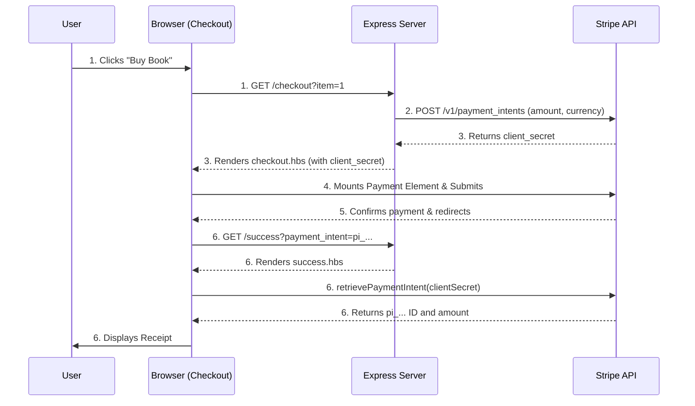

# Book Store Simple E-commerce App

## Description

This is a MVP version of e-commerce application based on node.js and Express that integrated with Stripe Elements, where a customer can use to purchase a book. It demonstrates a complete end-to-end payment flow, securely process a payment without leaving the site and view the payment success. 

The MVP focus on three actions:   

- Select a book to purchase.  
- Checkout and purchase the item using Stripe Elements.  
- Display a confirmation of purchase to the user with the total amount of the charge and Stripe Payment Intent ID (beginning with pi_).

## Application overview

This demo is written in Javascript (Node.js) with the [Express framework](https://expressjs.com/). You'll need to retrieve a set of testmode API keys from the Stripe dashboard (you can create a free test account [here](https://dashboard.stripe.com/register)) to run this locally.

We're using the [Bootstrap](https://getbootstrap.com/docs/4.6/getting-started/introduction/) CSS framework. It's the most popular CSS framework in the world and is pretty easy to get started with — feel free to modify styles/layout if you like. 

To simplify this project, we're also not using any database here, either. Instead `app.js` includes a simple switch statement to read the GET params for `item`. 

## Configuration

1.create a .env file in the root directory (refer to sample.env)
2.add your Stripe test keys: 

```
STRIPE_PUBLISHABLE_KEY=pk_test_your_key_here
STRIPE_SECRET_KEY=sk_test_your_key_here
```

3. Please ensure .env is listed in your .gitignore

## Running the App

1. Start the server `npm start`
2. Navigate to [http://localhost:3000](http://localhost:3000) to view the index page.

## Testing the Flow

Successful Payment: Use card 4242 4242 4242 4242, any future expiration date, and any CVC.
Declined Payment: Use card 4000 0000 0000 0002 to test the client-side error handling.

# Architecture

The application is built using Express.js with Handlebars for server-side rendering.



## The Flow

1. Selection: The user selects a book on the index page, triggering a GET /checkout?item=X request.
2. Server-Side Intent: The Express server calculates the amount (in cents) and calls the Stripe API to create a PaymentIntent.
3. Rendering: The server passes the client_secret and publishable_key to the Handlebars template.
4. Client-Side Mounting: Stripe.js (loaded via endive release train) uses the client_secret to mount the Payment Element into the DOM.
5. Confirmation: When the user submits, the client calls elements.submit() for validation, followed by stripe.confirmPayment().
6. Success: Stripe redirects the user to /success, appending the PaymentIntent ID and client secret to the URL. The client extracts these, calls stripe.retrievePaymentIntent(), and displays the final receipt.

# APIs Used & Architecture Choices

* **[Payment Intents API](https://docs.stripe.com/api/payment_intents):** Used to track the lifecycle of the payment on the server.
* **[Payment Element](https://docs.stripe.com/payments/payment-element):**  Used on the client to securely collect card details. As required by the assignment, I explicitly used the Payment Element rather than Stripe Checkout to retain full control over the UI and branding.
* **Security Model**: The server securely holds the STRIPE_SECRET_KEY. The client only receives the STRIPE_PUBLISHABLE_KEY and the client_secret. The browser can only confirm that specific PaymentIntent for that specific amount; it cannot alter the amount or access account secrets.

# Approach and Challenges

## My Approach

Coming from an enterprise architecture background, I focused on understanding the API contract before writing code. I primarily referenced the official Stripe "Accept a Payment" (Elements) documentation, the Payment Intents API Reference, and the Payment Element migration guide to understand the shift from legacy elements to the unified Payment Element.

## Documents References

1. Stripe Elements: ++[https://docs.stripe.com/payments/payment-element](https://docs.stripe.com/payments/payment-element)++
2. Payment Intents: ++[https://docs.stripe.com/payments/payment-intents](https://docs.stripe.com/payments/payment-intents)++

## Challenges Encountered

**Versioning and Compatibility:** The repository was built on an older Stripe Node SDK (v8). I faced console warnings and later migrated the client-side library to the newer endive release train to align with modern Stripe architecture.

**Silent JS Failures**: During the integration of the submit handler, minor typos (e.g., in variable names) caused silent syntax errors in the browser, halting execution and preventing the UI from rendering the price. I learned to lean heavily on the browser DevTools console to trace execution halts.

**Validation Flow:** I realized modern Stripe Elements require an explicit elements.submit() call before confirmPayment() to trigger UI validation and collect wallet data (like Link). I implemented this alongside button-disabling logic to prevent double-clicks.

**Skillset as a developer:** as being Enterprise Architect most of my life, I have limited backend node application experience, building this app without coding agent there's some learning curve. But I enjoyed the process and had a good understanding why Stripe is so popular! It's indeed very friendly for developer.

## **Future Extensions (Building a Robust Instance)**

If I were building this for production, I would implement the following architectural changes:

1. **Webhook-Driven Fulfillment:** Currently, fulfillment relies on the client-side redirect to `/success`. If a user closes their browser after paying but before the redirect, the system wouldn't know. In production, I would implement a server-side webhook endpoint listening for the `payment_intent.succeeded` event. Fulfillment (shipping the book) would only be triggered by this secure, server-to-server event.
2. **Idempotency:** While the client disables the button to prevent double-clicks, this is a UI patch. I would move PaymentIntent creation to a `POST` endpoint and pass an `Idempotency-Key` (e.g., tied to a Cart ID). This ensures that if the network fails and the client retries, Stripe returns the existing intent rather than creating a duplicate charge.
3. **Database Integration:** Replace the hardcoded `switch` statement in `app.js` with a database (e.g., PostgreSQL). This would allow dynamic inventory tracking, user accounts, and actual order recording.
4. **UI optimization:** If I have more time, I will revamp the UI and make it look better.
5. **Adoption on Stripe Checkout:** As Stripe Checkout gives more complete suite, and offers optimized UI, in the book store cases, the fast time to revenue and standard flows are what we need.
6. **Revamp the checkout experience using Checkout Studio**: which allows you to configure and monitor your checkout without writing code first and have more payment methods compared to MVP version